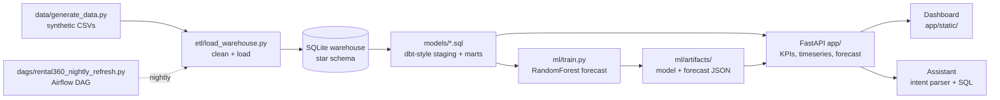

# Rental360 — AI-Powered Rental Business Intelligence & Predictive Analytics

An end-to-end analytics platform for equipment rental companies: synthetic rental
data → star-schema warehouse → dbt-style models → FastAPI reporting API →
scikit-learn demand forecasting → a deterministic AI assistant → a polished
web dashboard. Built as a portfolio project demonstrating data engineering,
machine learning, and full-stack delivery.

> **All data is synthetic.** Every transaction, customer, branch, and dollar
> figure in this repo was generated by `data/generate_data.py` (seed 42) for
> demonstration purposes. No real company, customer, or transaction is
> represented, and no number here should be quoted as real business data.

## What it answers

- Which equipment generates the most revenue — and which is sitting idle?
- Which branches and customers drive revenue?
- What will demand look like next month, per category and branch?
- Ask in plain English: *"Which branch generated the most revenue?"*,
  *"Which equipment is sitting idle?"*, *"What is the predicted demand next
  month?"* — the assistant answers from the warehouse with the SQL shown.

## Screenshots

Screenshots are generated from the running app with
`docs/take_screenshots.py` (Playwright + Chromium) — see that script for
setup. They live in `docs/screenshots/`:

- `dashboard-top.png` — KPI cards, revenue trend, branch performance
- `dashboard-bottom.png` — demand forecast, top customers, equipment utilization
- `assistant.png` — AI assistant answering a business question with its SQL

> Note: screenshots could not be captured in the original build environment
> (no headless browser available), so they are generated on first run in a
> browser-capable environment rather than committed here.

## Architecture



| Layer | Technology | Notes |
|---|---|---|
| Synthetic data | Python (stdlib) | Seeded, reproducible; 8 branches, 420 items, 320 customers, 7,327 rentals, 900 maintenance events over 2024-01-01 → 2026-10-31 |
| Warehouse | SQLite (default) + PostgreSQL schema | Star schema: `fact_rentals`, `fact_maintenance`, `dim_equipment`, `dim_customer`, `dim_branch`, `dim_date` |
| Transforms | dbt-style SQL models | `models/staging`, `models/marts`, `models/schema.yml`; materialised as views by `models/run_models.py` (real dbt compatible) |
| Quality | `etl/data_quality.py` | 15 checks: null PKs, negative values, referential integrity, duplicates, date ranges, utilization bounds |
| API | FastAPI + Uvicorn | 11 endpoints; read-only SQL; CORS enabled |
| ML | scikit-learn | RandomForest demand forecast (MAE 2.00, RMSE 2.59 on a 3-month hold-out) + z-score utilization anomaly detection |
| Assistant | Deterministic intent parser + SQL | 9 intents; every answer carries its SQL + evidence rows. **No LLM is called** — `app/llm_client.py` is an explicit seam for plugging one in later |
| Frontend | Vanilla JS + Chart.js 4 | No build step; served by FastAPI static files |
| Orchestration | Airflow DAG | `dags/rental360_nightly_refresh.py` (daily 02:00 UTC); the same steps run as plain commands |
| Deployment | Docker + docker-compose | Single container; warehouse rebuilt at image build time |

## Quick start

```bash
git clone <your-fork> rental360 && cd rental360
python -m venv .venv && source .venv/bin/activate
pip install -r requirements.txt

# 1. Generate synthetic data + build the warehouse
python data/generate_data.py
python etl/load_warehouse.py
python models/run_models.py
python etl/data_quality.py        # 15/15 checks

# 2. Train the forecast model
python ml/train.py                # writes ml/artifacts/
python ml/anomaly.py

# 3. Run the app
uvicorn app.main:app --port 8000
# Open http://localhost:8000 — dashboard + API docs at /docs
```

Or with Docker:

```bash
docker compose up --build
# http://localhost:8000
```

### One-command pipeline

```bash
make pipeline   # data -> ETL -> models -> quality -> train -> anomalies
make run        # start the API + dashboard
make test       # pytest
```

## API reference

| Endpoint | Description |
|---|---|
| `GET /api/health` | Liveness + synthetic-data flag |
| `GET /api/kpis` | Total revenue, rentals, avg utilization, idle count, top branch |
| `GET /api/revenue-timeseries?granularity=month\|quarter` | Revenue + rentals over time |
| `GET /api/branch-performance` | Revenue/rentals per branch |
| `GET /api/top-customers?limit=10` | Lifetime value ranking |
| `GET /api/equipment?category=&branch_id=&min_utilization=&limit=100` | Equipment with utilization |
| `GET /api/forecast?category=&branch_id=` | Next-month predicted rentals |
| `POST /api/assistant` | `{"question": "..."}` → answer + intent + SQL + evidence rows |
| `GET /api/branches`, `GET /api/categories` | Filter lists |
| `GET /` | Dashboard. `GET /docs` — OpenAPI docs |

### Assistant example

```bash
curl -X POST http://localhost:8000/api/assistant \
  -H 'Content-Type: application/json' \
  -d '{"question": "Which branch generated the most revenue?"}'
```

```json
{
  "answer": "Charlotte Queen City (Charlotte, NC) generated the most revenue: $2,941,464.08 across 1,204 rentals (average rental value $2,443.08). Revenue here is billable revenue, which excludes cancelled rentals.",
  "intent": "top_branch",
  "sql": "SELECT branch_id, branch_name, city, state, rental_count, total_revenue, avg_rental_value, avg_rental_days FROM mart_revenue_by_branch ORDER BY total_revenue DESC LIMIT 1",
  "rows": [{"branch_id": "BR-08", "branch_name": "Charlotte Queen City", "...": "..."}]
}
```

## The data, honestly

- **Synthetic, seeded (42), reproducible.** Re-running the generator yields the
  same dataset; change `--seed` for a different one.
- **Two revenue figures, both labelled.** The headline total
  ($18,712,625.17) is `SUM(total_revenue)` over all rentals, including the 144
  cancelled rentals' booked value ($369,547.54). Branch/category marts and the
  timeseries use **billable revenue** ($18,343,077.63), which excludes
  cancelled rentals. The assistant states both wherever they differ.
- **Deliberate data-quality issues** (6 duplicate rentals, 4 missing daily
  rates, 3 uppercase statuses) are injected by the generator so the ETL's
  cleaning rules are exercised and reported on every run.
- **Forecast limits.** The model trains on 34 months of synthetic history
  (mean ≈ 3.8 rentals per category×branch per month). Hold-out MAE ≈ 2.0 is
  weak in absolute terms — honest for noisy, short series with no external
  drivers (weather, economy, seasonality beyond month-of-year). See
  `ml/README.md` for the full discussion. Forecasts are demo outputs, not
  business advice.

## Tests

```bash
pytest            # 48 tests: ETL cleaning + edge cases, API/KPIs, assistant
                  # intents + hostile inputs, forecast training + anomalies
```

## Project layout

```
rental360/
├── app/                  FastAPI backend + assistant + static dashboard
│   ├── main.py           API endpoints, static mount
│   ├── assistant.py      deterministic intent parser + read-only SQL
│   ├── llm_client.py     LLM seam (stub — no provider configured)
│   ├── db.py             read-only SQLite helper
│   └── static/           dashboard (index.html, styles.css, app.js)
├── data/
│   ├── generate_data.py  synthetic data generator (seeded)
│   └── raw/              generated CSVs (regenerable, committed for convenience)
├── db/                   schema.sql (SQLite) + schema_postgres.sql
├── dags/                 Airflow nightly-refresh DAG
├── docs/screenshots/    dashboard screenshots
├── etl/                  load_warehouse.py, data_quality.py
├── ml/                   train.py, forecast.py, anomaly.py, artifacts/
├── models/               dbt-style staging + marts + schema.yml + run_models.py
├── tests/                pytest suite (48 tests)
├── Dockerfile            docker-compose.yml  .env.example  Makefile
└── requirements.txt
```

## Roadmap / known gaps

- [ ] Plug a real LLM into `app/llm_client.py` (guardrailed: LLM proposes intent/parameters only; SQL stays fixed and read-only).
- [ ] Postgres deployment path (schema provided; ETL currently targets SQLite).
- [ ] Airflow DAG tested against a live Airflow instance (DAG file provided, not yet executed in Airflow).
- [ ] Dashboard end-to-end browser test (verified via API + static checks;
  `docs/take_screenshots.py` generates the README screenshots — run it in a
  browser-capable environment).

## License

MIT. Synthetic data only — no real business data is included or claimed.
